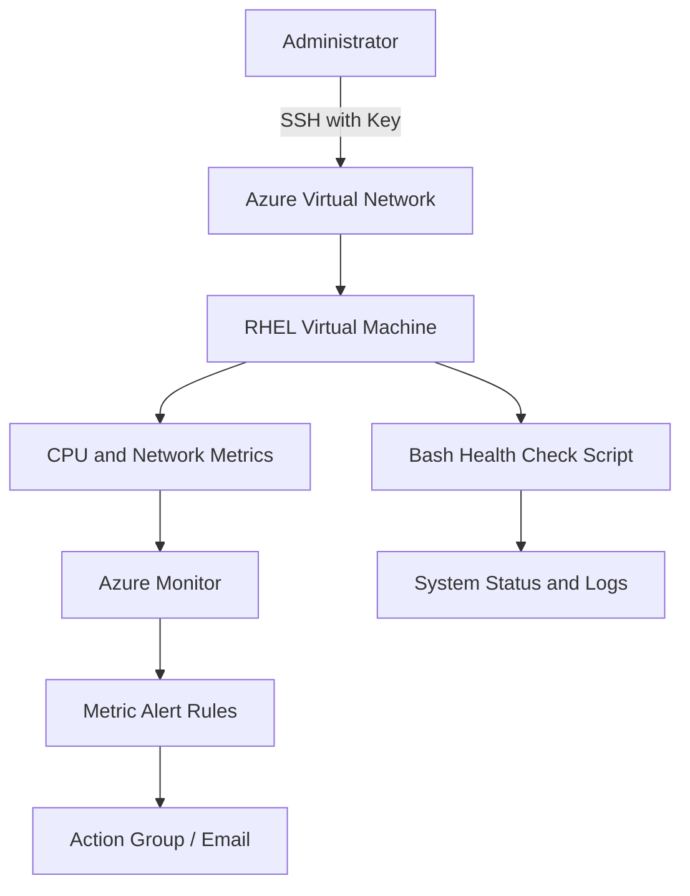

# Azure Infrastructure Monitoring

**Monitoring Linux infrastructure on Microsoft Azure using RHEL, Azure Monitor, and Bash scripting.**


## Overview

Azure Infrastructure Monitoring is a hands-on cloud engineering project focused on monitoring the health and performance of a Red Hat Enterprise Linux (RHEL) virtual machine hosted on Microsoft Azure.

The project demonstrates cloud infrastructure management, Linux system administration, performance monitoring, alert configuration, Bash automation, troubleshooting, and cost-conscious resource management.

## Project Objectives

- Deploy and configure a RHEL virtual machine in Microsoft Azure.
- Establish secure remote access using SSH key authentication.
- Monitor infrastructure metrics such as CPU utilization and network activity.
- Configure metric-based alerts for potential performance issues.
- Automate Linux health checks using Bash scripting.
- Investigate system errors, failed services, memory usage, and disk utilization.
- Apply cloud security and resource cleanup practices.

## Architecture



*The architecture represents the planned design. Components will be marked complete after implementation and testing.*

## Technology Stack

| Technology | Purpose |
|---|---|
| Microsoft Azure | Cloud infrastructure platform |
| Azure Virtual Machines | Hosts the Linux server |
| Red Hat Enterprise Linux | Server operating system |
| Azure Monitor | Collects and analyzes monitoring metrics |
| Azure Monitor Agent | Collects guest-level telemetry when configured |
| Azure Monitor Alerts | Detects configured metric thresholds |
| Bash | Automates Linux health checks |
| SSH | Secure remote administration |
| Git and GitHub | Version control and project documentation |

## Implementation Plan

### 1. Cloud Infrastructure Setup

- Create an Azure resource group.
- Deploy a RHEL virtual machine using a suitable image and size.
- Configure SSH key-based authentication.
- Restrict inbound access using network security rules.
- Review estimated resource and software licensing costs.

### 2. Linux System Administration

Use standard Linux commands to inspect system health.

| Command | Description |
|---|---|
| `uptime` | Displays uptime and load averages |
| `top` | Shows running processes and CPU activity |
| `free -h` | Reports memory utilization |
| `df -h` | Displays filesystem capacity |
| `du -sh /var/log` | Estimates log directory size |
| `systemctl --failed` | Lists failed system services |
| `journalctl -p err -b` | Displays error-level logs from the current boot |
| `ip addr` | Displays network interfaces and IP addresses |

### 3. Infrastructure Monitoring

Configure Azure Monitor to inspect:

- CPU utilization and performance trends.
- Network traffic and activity.
- VM availability and health.
- Guest-level memory and disk metrics, when the required agent and data collection configuration are enabled.

### 4. Alert Configuration

Create a metric alert rule for high CPU utilization.

Example configuration:

- **Metric:** Percentage CPU
- **Threshold:** Greater than 80%
- **Evaluation:** Configure a suitable evaluation frequency and lookback period.
- **Notification:** Use an action group for email notifications if required.

The threshold is an example and should be adjusted for the workload. Alert rules and notifications must be tested before claiming successful alert delivery.

### 5. Bash Health Check Automation

Develop a Bash script that collects basic Linux health information, including:

- Operating system details.
- Uptime and load averages.
- Running processes.
- Memory and disk utilization.
- Failed services.
- Recent system errors.

The script is intended to simplify routine system checks and provide useful troubleshooting evidence.

## Security Best Practices

- Use SSH keys instead of password-based remote access where appropriate.
- Restrict SSH access to trusted source IP addresses.
- Apply least-privilege access to Azure resources.
- Keep private keys, credentials, and secrets out of GitHub.
- Review network security rules regularly.
- Remove unused cloud resources after testing.

## Cost Optimization

- Choose an appropriately sized virtual machine.
- Review RHEL image licensing before deployment.
- Monitor resource consumption and estimated costs.
- Stop or delete resources when they are no longer required.
- Check for remaining disks, public IP addresses, and monitoring resources after cleanup.

Stopping a VM does not necessarily eliminate every associated charge.

## Repository Structure

```text
azure-infrastructure-monitoring/
├── README.md
├── scripts/
│   └── health-check.sh
├── docs/
│   ├── architecture.md
│   ├── troubleshooting.md
│   └── cost-cleanup.md
└── screenshots/
    ├── vm-overview.png
    ├── linux-health-check.png
    ├── azure-monitor-metrics.png
    └── cpu-alert-rule.png
```

*Add each file and screenshot as it is created. Do not include placeholder screenshots as real project evidence.*

## Troubleshooting Scenarios

| Scenario | Investigation |
|---|---|
| High CPU utilization | Inspect Azure metrics, `top`, and `uptime` |
| Low available memory | Review `free -h` and running processes |
| Disk space exhaustion | Check `df -h` and directory usage |
| Failed system service | Inspect `systemctl status` and `journalctl` |
| SSH connection failure | Check VM status, SSH configuration, IP address, and network rules |
| Missing monitoring data | Verify metric availability, agent configuration, and data collection settings |
| Alert notification not received | Check alert state, action group configuration, and notification delivery |

## Learning Outcomes

This project is designed to develop practical skills in:

- Cloud infrastructure provisioning.
- Linux server administration.
- Infrastructure monitoring and alerting.
- Bash scripting and automation.
- Troubleshooting and log analysis.
- Cloud security and cost management.
- Technical documentation and version control.

## Future Enhancements

- Provision Azure resources using Terraform.
- Automate recurring health checks.
- Configure guest-level memory and disk monitoring.
- Build a dashboard for infrastructure metrics.
- Expand alerting and incident troubleshooting documentation.

## Project Status

**Status:** In progress.

This repository documents the project design and implementation. Completed features, screenshots, and results will be updated as they are deployed and verified.

## Author

**Digvijay Yadav**

Aspiring Cloud Engineer | AWS Certified Solutions Architect – Associate | Linux and Cloud Infrastructure

---

*This project is intended for educational and portfolio purposes. Resource availability, configuration, and costs depend on the Azure subscription and selected services.*
